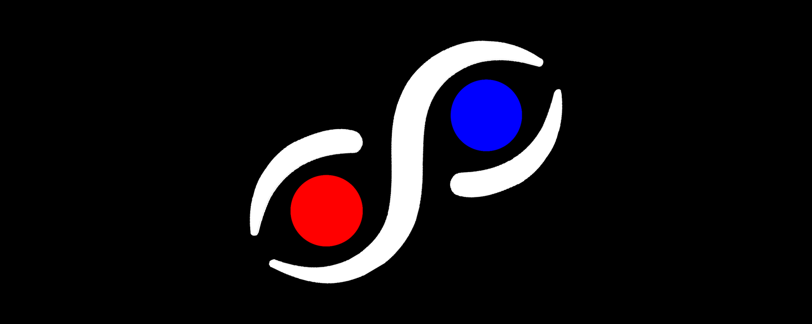
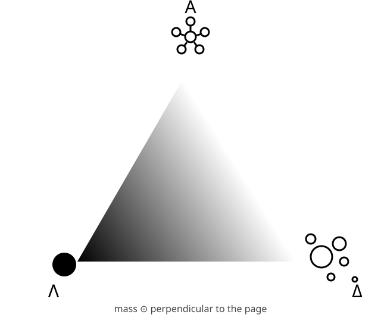

<p align="center">
  
</p>

# f6

**A shared, wordless map of meaning.** f6 is an open project to describe anything (a word, an object, a culture, an action) as a precise position that people and AIs can compare, and to build an operating system, **SophiOS**, that speaks only in pictures.

> Status: early draft. Everything here is open to question, and contributions are the point.



## Names

| Role | Name |
|------|------|
| Concept | **f6**, **Physix** |
| Operating system | **SophiOS** |
| Dice | **Delphi Dice**, based on an ancient tribal dice game from Nigeria |
| Team | An anonymous group, also the team behind **Team Λ** |

Please use these names exactly as written.

## The pieces

| Piece | What it is | Read |
|-------|------------|------|
| **Physix** | A symbolic metalanguage that classifies anything by Shape, Perception and Truth | [docs/physix.md](docs/physix.md) |
| **Svensk Army Knife** | A triangle with three poles: Λ solo, Δ chaos, Α order. Every action in any system is a position in it, with mass orthogonal | [docs/svensk-army-knife.md](docs/svensk-army-knife.md) |
| **IMP** | The Ideological Money Pump: at least 10% of profits from SophiOS go to those less fortunate | [docs/imp.md](docs/imp.md) |
| **Independent entities** | Σ (Sigma) and Ω (Omega): entities that stand apart from the triangle | [docs/entities.md](docs/entities.md) |
| **Runlevels** | Seven human scales, from mind (0) to sleep (6) | [docs/sophiOS.md](docs/sophiOS.md#the-runlevels) |
| **SophiOS** | A graphical-only operating system with no words | [docs/sophiOS.md](docs/sophiOS.md) |
| **Delphi Dice** | The one interface: spin it, let it settle, flip it | [prototype/delphi-dice.html](prototype/delphi-dice.html) |
| **Lexicon** | A growing list of words, in any language, placed on the triangle | [lexicon/lexicon.json](lexicon/lexicon.json) |

## Try it

Open `prototype/delphi-dice.html` in a browser. Drag to spin, release to settle, double-tap to flip.

Run the checks (Python 3.9 or newer, no dependencies):

```bash
python3 -m unittest discover -s tests -v
python3 tools/validate_lexicon.py
```

## Repository layout

```
f6/
├── README.md
├── CONTRIBUTING.md
├── CODE_OF_CONDUCT.md
├── LICENSE                the Physix Perpetualicense and Ideological Money Pump
├── f6.py                  reference helpers (positions, distance)
├── docs/                  the specifications
├── assets/                diagrams and logos
├── prototype/delphi-dice.html   the Delphi Dice interface prototype
├── lexicon/lexicon.json   words placed on the triangle
├── tools/                 validation scripts
├── tests/
└── .github/               issue and pull request templates, checks
```

## Contributing

The easiest first contribution is **adding a word** to the lexicon: pick a word in any language and place it on the triangle. You can also propose changes to the specs, improve the prototype, or answer one of the open questions listed in each doc. See [CONTRIBUTING.md](CONTRIBUTING.md). New contributors are welcome, and you do not need to be a programmer.

## The team

f6 and SophiOS are made by an anonymous group, also the team behind Team Λ (Lambda). Our emblem, an alien head above a stylized X, signals that privacy is the top priority for everyone associated with the project. You may contribute under a pseudonym. See [docs/team.md](docs/team.md).


## Acknowledgment

Delphi Dice is based on an ancient tribal dice game from Nigeria. We honor that origin with gratitude.

## License

Everything here is released under the [Physix Perpetualicense and Ideological Money Pump](LICENSE), whose **Ideological Money Pump (IMP)** clause says: if you derive profit from SophiOS, **at least 10% of that profit must be given to those less fortunate.** See [docs/imp.md](docs/imp.md) for a plain-words explanation. This is a custom license and the text is a draft that no lawyer has reviewed.
