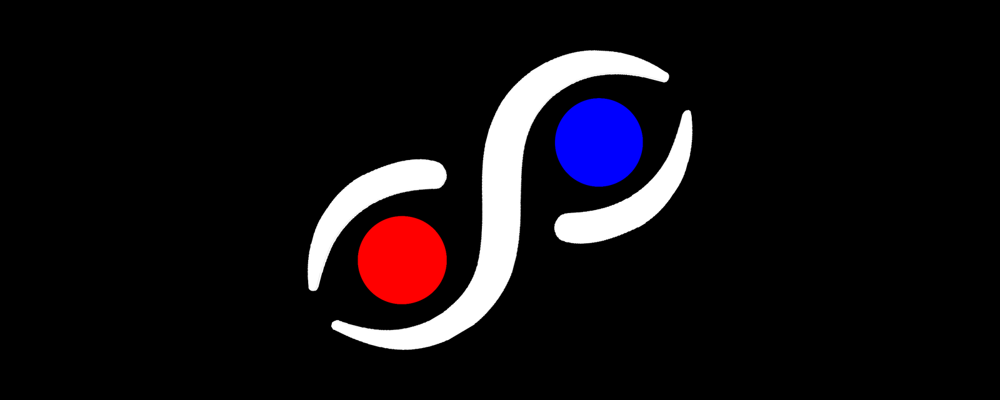

  

# SophiOS

*A picture-only operating system, steered by a single Delphi Dice.*

Thank you for reading. This document has two parts: a short, friendly version anyone can follow (even a 10-year-old), and a formal version for builders and other AIs.

---

## Part 1: The Idea in Simple Words

Imagine a computer with **no words at all**. No menus, no buttons that say "Open" or "Save". Just pictures, colors, and one special shape you can touch.

That shape is a **Delphi Dice**. It looks like two pyramids glued together: one end is **white**, the other end is **black**, and around the middle are three corners: **red, green and blue**.

Here is how you talk to the computer:

- **Spin it.** Drag the Delphi Dice with your finger and it twirls like a spinning top.
- **Let go.** It slows down and stops on one of three sides.
- **Flip it.** Tap twice and it turns upside down. White means **no**. Black means **yes**.

Spin, stop, flip. That's the whole conversation.

### The triangle

The computer keeps a little map in its head: a **triangle with three corners**.

- **Corner 1: one solid dot.** Just one, all alone.
- **Corner 2: scattered bubbles of different sizes.** Messy and mixed up.
- **Corner 3: five circles joined in a ring.** Neat and connected.

Anything can be placed on this triangle: a game, a school, a whole country. It sits closer to the corner it is most like. The map also tracks how **big or heavy** the thing is.

### The rooms

People spend their day in different "rooms". SophiOS calls them **runlevels**:

| Level | The room | In kid words |
|:-----:|----------|--------------|
| 0 | Mind | Thoughts and ideas inside your head |
| 1 | Alone | Just me, nobody else around |
| 2 | Together | Me and one other person: a friend, a parent, a teacher |
| 3 | Family | Mom, dad, kids: the people at home |
| 4 | Culture | Many families who share the same values, and the things they do *not* do just for money |
| 5 | Economy | Things people do *for* money |
| 6 | Sleep | Resting and dreaming |

A person is in one room at a time, and SophiOS changes what the pictures show to match.

Why no words? Because a picture means the same thing to everybody, whether they speak Swedish, Yoruba, English or Japanese, or haven't learned to read yet.

---

## Part 2: Formal Proposition

### Statement

> **SophiOS is a graphical-only operating system in which the sole human interface is the Delphi Dice, and in which every state is described by four things: its Physix tag (what it is), its position in the Svensk Army Knife (where it sits between solo, chaos and order), its mass (how much of it there is), and its runlevel (which human scale it belongs to).**

### The four descriptors

| Descriptor | Defined in | Values |
|------------|------------|--------|
| Physix tag | [physix.md](physix.md) | Shape, Perception, Truth |
| Position | [svensk-army-knife.md](svensk-army-knife.md) | `(λ, δ, α)`, sum 1: Λ solo, Δ chaos, Α order |
| Mass | [svensk-army-knife.md](svensk-army-knife.md) | Orthogonal to the position; units to be defined |
| Runlevel | below | Integer 0 to 6 |

### The runlevels

Runlevels are the human analog of an operating system's run states. A computer has "single-user" and "multi-user" modes; a human has *homothink* (mental) and *homodo* (acting in the world), spread across seven levels:

| Level | Name | Definition | Symbol |
|:-----:|------|------------|:------:|
| 0 | Mental | Thoughts, abstractions, things that exist only in mind | 0 |
| 1 | Self | Alone; no one around | 一 |
| 2 | Dyad | With one other: spouse, child, teacher, friend | 二 |
| 3 | Family | Mother, father, children (the default household) | 三 |
| 4 | Culture | Many families with similar values; what they do **not** do for money | iv |
| 5 | Economy | What is done **for** money | V |
| 6 | Sleep | Physical rest and dreaming | vi |

Culture (iv) and Economy (V) are deliberately split: the same activity can sit on either side depending on whether it is done for money.

### The Delphi Dice as the only interface

The Delphi Dice is a triangular bipyramid: five corners, six triangular faces. A prototype is in [`prototype/delphi-dice.html`](../prototype/delphi-dice.html).

| Part of the Delphi Dice | Role in SophiOS |
|------------------|-----------------|
| White pole | ⚪ FALSE / no (matches Physix Truth) |
| Black pole | ⚫ TRUE / yes (matches Physix Truth) |
| Three equator colors | Three outcomes of a spin |
| Drag | Spin: set the system in motion |
| Release | Settle: come to rest on one outcome |
| Double-tap | Flip: answer no (white) or yes (black) |

Six faces are three outcomes times two truth values. Seen from a pole, the Delphi Dice's equator is itself a triangle with three corners, which fits naturally with the three poles Λ, Δ, Α. Which color maps to which pole is a design decision still to be made.

The prototype already names its three resting outcomes with these symbols (`Δ2A`, `Λ`, `A1`) and has an *embedded mode* that hides the text label and passes it to a parent program. SophiOS can use this directly: the Delphi Dice shows **no words**, and the operating system receives the label silently.

### Independent entities

Two entities stand outside the triangle (see [entities.md](entities.md)): **Σ (Sigma)**, an independent entity sorted by color, 🔵 good or 🔴 bad; and **Ω (Omega)**, an independent entity that refuses to communicate with the Delphi Dice. The Dice can never answer on an Omega's behalf, so SophiOS needs a wordless way to show that refusal.

### Design rules

1. **No words.** Every screen is made of shapes, color, motion and position only.
2. **One instrument.** The Delphi Dice is the only control a person must learn.
3. **Four descriptors, always.** Every state carries a Physix tag, a position, a mass and a runlevel.
4. **Universal by default.** Nothing may depend on a spoken or written language.
5. **Yes and no are physical.** White and black are felt as a flip, not read as text.

### Open questions

- **Six faces, seven levels.** Does the context choose the runlevel while the Delphi Dice chooses the answer, or is level 0 a resting state with six active levels?
- **Prototype labels.** `A1`, `Δ2A` and `Λ` appear to mix chaos letters with runlevel numbers. Should each be split into a separate position and runlevel?
- **Λ versus runlevel 1**, and **mass versus runlevel**: see [open questions](svensk-army-knife.md#open-questions).
- **How does the Delphi Dice set mass?** Spin speed is one possibility.
- **Showing an Ω without words.** See [entities.md](entities.md#open-questions).
- **Symbols for levels 3 to 6.** Still to be chosen.
- **Accessibility.** People with color-vision differences or low vision need shape and motion to carry meaning alongside color.

---

## Acknowledgment

Delphi Dice is based on an **ancient tribal dice game from Nigeria**. We honor that origin with gratitude, and we hope SophiOS carries the spirit of a game that people everywhere could pick up and understand without needing a single word.

*With thanks and respect.*
