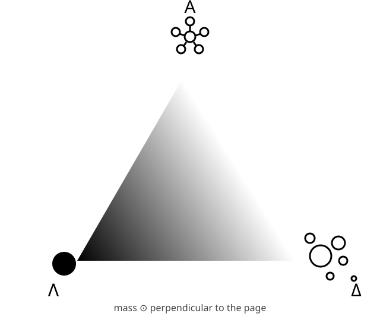

# The Svensk Army Knife

*One small tool for placing anything on a map.*



## The idea

For **any system**, three poles describe where it sits:

| Pole | Glyph | Meaning |
|:----:|-------|---------|
| **Λ** (lambda) | one solid dot | **Solo entity.** One alone. |
| **Δ** (delta) | scattered circles of different sizes | **Chaos.** |
| **Α** (alpha) | five circles joined in a ring | **Order.** |

Any system can be seen as a state **between most chaotic, most ordered, and alone.**

The triangle is a **2D space where every action in any system occurs.** Whether you are describing a chaotic culture, an ordered state, or individual liberties, each one is a **position** in the same triangle.

The glyphs use shape only, so they work in a words-free interface (see [SophiOS](sophiOS.md)).

## Coordinates

A position is three non-negative numbers that add up to 1:

```
(λ, δ, α)    λ + δ + α = 1
```

- `(1, 0, 0)` is pure Λ: completely solo.
- `(0, 1, 0)` is pure Δ: complete chaos.
- `(0, 0, 1)` is pure Α: complete order.
- `(⅓, ⅓, ⅓)` is the exact centre: an even blend.

The three numbers are the closeness to each pole (barycentric coordinates). Because they sum to 1, only two are free, which is why the whole thing is a flat 2D space. For drawing, `f6.py` maps a position to `(x, y)` with Λ at `(0, 0)`, Δ at `(1, 0)` and Α at `(0.5, √3/2)`.

## Mass: the orthogonal axis

**Mass is orthogonal** to the triangle: it points out of the page. The position says *what kind of state* something is in; mass says *how much of it there is*. Two systems can share a position and differ enormously in mass (a village and a nation, both ordered).

> Units for mass are not yet defined. The lexicon uses a relative 0 to 1 placeholder. Proposals welcome (see [open questions](#open-questions)).

## Reading it: examples

These are seed values for discussion, taken from [`lexicon/lexicon.json`](../lexicon/lexicon.json).

| Word | λ | δ | α | Reads as |
|------|:-:|:-:|:-:|----------|
| individual liberty | 0.80 | 0.10 | 0.10 | near the solo pole |
| chaotic culture | 0.10 | 0.80 | 0.10 | near the chaos pole |
| ordered state | 0.05 | 0.05 | 0.90 | near the order pole |
| market | 0.10 | 0.50 | 0.40 | between chaos and order: ordered rules, chaotic outcomes |
| alone / ensam | 0.95 | 0.03 | 0.02 | same place in two languages |

## Entities outside the triangle

Not everything is a position. [Σ and Ω](entities.md) name independent entities that are not defined by their place on the triangle: a Σ is sorted by color (🔵 good, 🔴 bad), and an Ω refuses to communicate with the Delphi Dice.

## Why this makes language precise

A word like "freedom" can mean different things to different speakers, and the difference usually stays hidden. The Svensk Army Knife **reifies** a word: it turns it into a point you can see and measure.

- Two words that mean the same thing land on the same point, in any language (`alone` and `ensam` above).
- When two people disagree about a word, the disagreement becomes a **distance** between their two points, which can be discussed and measured (`distance()` in `f6.py`) instead of argued in circles.

An honest limit: *choosing* the coordinates is still a human judgment. The tool does not remove that judgment. It removes the hiding place, by making each judgment explicit, comparable and open to challenge.

## How it fits with the rest of f6

| Piece | Question it answers |
|-------|---------------------|
| [Physix](physix.md) | What kind of thing is it? (Shape, Perception, Truth) |
| **Svensk Army Knife** | Where does it sit between solo, chaos and order? |
| Mass | How much of it is there? |
| [Runlevel](sophiOS.md#the-runlevels) | Which human scale is it at (mind, self, pair, family, culture, economy, sleep)? |

The Svensk Army Knife replaces the old Physix "Chaos" layer, which crammed three ideas into one slot. Now the three ideas are the three corners of a space.

## Open questions

- **Units of mass.** What is being measured: people involved, energy, matter, attention?
- **Λ versus runlevel 1.** Runlevel 1 is "alone", and Λ is "solo entity". Are they the same thing seen twice, or different (for example, one is a scale and the other a character)?
- **Mass versus runlevel.** Runlevels roughly climb with the number of people involved. Is mass partly the same thing?
- **Precision.** How many decimal places are meaningful? Is a coarse grid enough?
- **Calibration.** Should there be reference words that everyone agrees on, to anchor the map?

Open an issue to discuss any of these.
