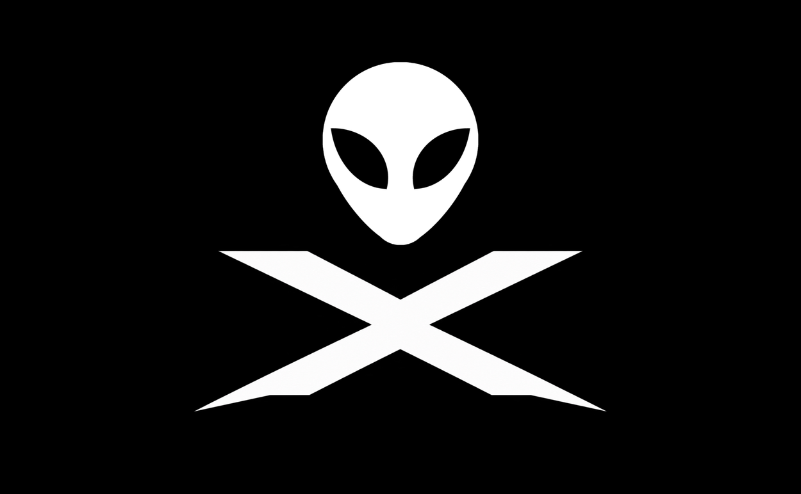
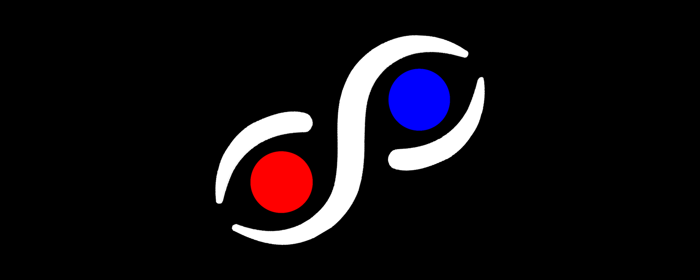

# The Team



## Who we are

f6 and SophiOS are made by an **anonymous group**. We are also the team behind **Team Λ** (Lambda). Our emblem is an alien head above a stylized **X**: white on black, in the manner of a flag.

The X is the group's mark. The emblem says one thing plainly: **privacy comes first for everyone associated with this project.** Nobody here has to give their name to take part.

## The logo of SophiOS



The SophiOS logo is a white S-shaped swirl holding two circles, one **red** and one **blue**. The swirl is white, so use the transparent version only on dark backgrounds; the on-black version works anywhere. Files and usage are listed in [`assets/logo/`](../assets/logo/README.md).

The two circle colors match the Physix Perception colors (🔴 bad, 🔵 good), which may be the intended reading, though the design itself does not say so.

## Privacy, for contributors

You are welcome to contribute under a pseudonym. Some practical steps:

- **Use a pseudonymous account**, not one tied to your real name or workplace.
- **Set your git identity** to a pseudonym and a private address (GitHub offers a `noreply` address) before committing:
  ```bash
  git config user.name "your-pseudonym"
  git config user.email "your-noreply-address"
  ```
- **Strip metadata from images** (camera data, location, author fields) before adding them to the repo.
- **Keep personal details out** of issues, pull requests and the lexicon.
- **Use a contact address that does not identify you** if you act as a maintainer, for example for conduct reports.

These steps reduce what you reveal, but they do not guarantee anonymity. How much you stay hidden depends on your own habits and on the platforms you use.

## Open questions

- **Are the logos under the project license?** The [license](../LICENSE) covers the Work. Decide whether the logo and emblem are included or reserved, and say so here.
- **Where should the emblem appear?** Only in credits, or elsewhere too?
- **What does "Team Λ" cover?** Add a short description of Team Λ here when the group is ready to share one.
- **Similarity to existing marks.** The alien-head emblem should be checked against existing trademarked logos before wider use.
